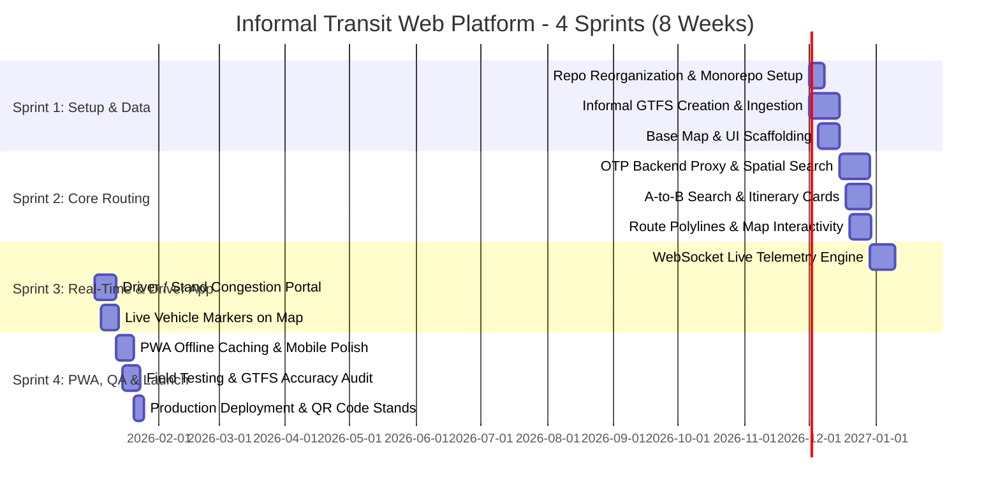

# 🚍 Informal Public Transit Routing Web Platform: 5-Contributor Game Plan

> **Problem Statement:** Unorganized shared mobility options (auto-rickshaws, shared taxis, mini-buses/matatus/trufis) lack unified route and stop information, causing severe road congestion, chaotic boarding, and long, unpredictable commuter wait times.
>
> **Project Goal:** Build a fast, lightweight, mobile-first Web Application (PWA) alternative to traditional mobile transit apps, designed specifically for informal transit dynamics (frequency-based departures, flexible stops, dynamic fares, and crowd-sourced stand congestion).

---

## 1. Repository Reorganization & Monorepo Blueprint

To pivot from Dart/Flutter to a modern Web + API stack, we organize the repo as an integrated monorepo. The original Dart logic remains available as a reference in [Trufi Core](https://github.com/trufi-association/trufi-core).

> **Status: done** (branch `infra/monorepo-reorg`). Decisions made while scaffolding:
> - **Web & driver portal:** Vite + React 19 + TypeScript (not Next.js: a static PWA needs no SSR and Vite builds in ~100 ms).
> - **Server:** Fastify 5 + TypeScript, so `shared-types` is used directly by the API. `/plan`, `/stands` and `/telemetry/reports` return mock fixtures until OTP lands.
> - **Tooling:** pnpm 12 workspaces, TypeScript 7, Vitest, Prettier; CI in `.github/workflows/ci.yml` runs typecheck, lint, test, build.
> - **Legacy:** the original Flutter code is available in the upstream Trufi Core repository, not in this web project.
>
> Setup: [docs/CONTRIBUTOR_SETUP.md](docs/CONTRIBUTOR_SETUP.md). API: [docs/API_SPEC.md](docs/API_SPEC.md).

### Proposed Directory Layout

```text
transit/
├── apps/
│   ├── web/                     # Contributor 1 & 2: Next.js / Vite + React + TypeScript + PWA
│   │   ├── src/
│   │   │   ├── components/      # UI components (Search, Itinerary, StopCard, FareTable)
│   │   │   ├── map/             # MapLibre GL engine, layers, route polylines, vehicle markers
│   │   │   ├── hooks/           # useGeolocation, useRouteQuery, useLiveVehicles
│   │   │   └── pages/           # / (Commuter Planner), /lines (Browse), /operator (Driver view)
│   │   ├── public/              # Icons, manifest.json, offline service-worker
│   │   └── package.json
│   │
│   ├── server/                  # Contributor 3: Node.js (Fastify/Express) or Python (FastAPI)
│   │   ├── src/
│   │   │   ├── routes/          # /api/v1/plan, /api/v1/routes, /api/v1/stands, /api/v1/telemetry
│   │   │   ├── services/        # OTP proxy, spatial search, ETA calculator, fare engine
│   │   │   ├── websocket/       # Real-time vehicle positions & stand crowd congestion
│   │   │   └── index.ts
│   │   └── package.json
│   │
│   └── driver-portal/           # Contributor 5: Lightweight mobile-web dispatcher for auto stands
│       └── ...
│
├── packages/
│   └── shared-types/            # Contributor 1, 2, 3: Shared TypeScript interfaces & DTOs
│       ├── src/
│       │   ├── transit.ts       # Route, Stop, Itinerary, Leg, Fare
│       │   ├── telemetry.ts     # VehiclePosition, CongestionLevel, StandStatus
│       │   └── index.ts
│       └── package.json
│
├── data/                        # Contributor 4: Informal transit GTFS, OSM tools & scripts
│   ├── gtfs/                    # routes.txt, stops.txt, frequencies.txt (Informal frequency data)
│   ├── geojson/                 # Raw auto-rickshaw / minibus corridor tracks (KML/GPX/GeoJSON)
│   └── pipelines/               # Python scripts to convert GPS traces into GTFS
│
├── deploy/                      # Contributor 5: Docker, docker-compose, CI/CD, NGINX
│   ├── docker-compose.yml       # Local dev: Web + Server + Redis + OpenTripPlanner
│   └── Dockerfile.web
│
├── docs/                        # Architecture, API specifications, onboarding guides
│   ├── API_SPEC.md
│   └── CONTRIBUTOR_SETUP.md
│
├── GAME_PLAN.md                 # This master game plan
├── README.md                    # Updated project overview & quickstart
└── package.json                 # Monorepo root (pnpm/npm workspaces)
```

---

### Implementation status (2026-11-24)

| Contributor | Status | Highlights (details in [nitish.md](nitish.md)) |
| :--- | :--- | :--- |
| C1 Commuter UX | ✅ Sprints 1–4 scope | Bottom sheet, search + GPS, itinerary cards with live waits, Nearby lines, PWA offline + install, shareable/QR trip URLs |
| C2 Map | ✅ | MapLibre + OpenFreeMap, route lines, live stands & animated vehicles, Nearby radius, long-press to pick, offline tiles |
| C3 Backend | ✅ | GTFS-backed network, built-in frequency planner (OTP client + fallback), fare engine, live stand state, WebSocket, OpenAPI |
| C4 Data | ✅ pilot | 7 corridors / 23 stops → validated GTFS with `frequencies.txt`, stop clustering, OTP packaging (stdlib Python) |
| C5 DevOps & driver portal | ✅ | Bilingual driver portal with offline outbox, oxlint, Playwright E2E, CI (4 jobs), Docker stack, deployment guide |

Still open: field-surveyed GPS traces/headways/fares (C4), real driver GPS feed and Redis-backed
multi-instance state (C3), live OTP verification with an OSM extract (C3/C5), production hosting (C5).

## 2. Five-Contributor Matrix & Roles

| Contributor | Role & Domain | Primary Tech Stack | Key Deliverables |
| :--- | :--- | :--- | :--- |
| **Contributor 1** | **Frontend Lead & Commuter UX** | React / Next.js, Tailwind CSS, Shadcn/UI, Workbox (PWA) | Mobile-first UI, A-to-B Search bar, Itinerary cards, Nearby Lines modal, PWA offline caching |
| **Contributor 2** | **Geospatial & Map Visualization** | MapLibre GL JS / Leaflet, Turf.js, Vector Tiles, Photon/Nominatim | Interactive map canvas, route polyline renderers, stop cluster markers, live animated vehicle pings, turn-by-turn visualizer |
| **Contributor 3** | **Backend API & Routing Engine** | Node.js (TypeScript) / Python (FastAPI), OpenTripPlanner (OTP), Redis, WebSockets | Unified Transit API, OTP proxy, spatial search for nearby stops, real-time WebSocket broker, fare calculation engine |
| **Contributor 4** | **Data Engineering & GTFS Specialist** | Python (Pandas, GeoPandas), OSM/Overpass, GTFS Tools | Informal transit data pipeline (GPS/traces $\to$ GTFS), `frequencies.txt` generator, auto-stand clustering, corridor speed profiling |
| **Contributor 5** | **DevOps, QA & Driver/Operator Hub** | Docker, GitHub Actions, Vercel/Railway/Cloud, WebSockets | Monorepo CI/CD, Docker Compose stack, Driver/Stand Dispatch Web App (crowd reporting), E2E testing |

---

## 3. Deep-Dive Contributor Breakdown & Tasks

### 👤 Contributor 1: Frontend Lead & Commuter Experience
* **Focus:** Build a mobile-optimized web app that requires zero installation, loads under 1.5 seconds on 3G/4G, and provides intuitive transit navigation.
* **Key Tasks:**
  1. Scaffold `apps/web` with responsive layout (floating bottom-sheet UI like Google Maps / Trufi mobile).
  2. Implement origin & destination search inputs with debounced geocoding suggestions and GPS "Current Location" button.
  3. Create Itinerary Result Cards: Show total duration, walking legs, informal transit legs (auto/minibus), estimated fare, and live arrival badges.
  4. Build "Nearby Lines" drawer: Displays all routes passing within 100m, 300m, or 500m of user position.
  5. Configure PWA support: Service worker caching for offline route viewing and "Add to Home Screen" prompt.
* **Dependencies:** Consumes API endpoints from Contributor 3; embeds Map component from Contributor 2.

---

### 👤 Contributor 2: Geospatial & Interactive Mapping Engineer
* **Focus:** Ensure silky-smooth map interaction, route polyline rendering, stop pinpointing, and live vehicle visualization.
* **Key Tasks:**
  1. Set up MapLibre GL JS (or Leaflet) with open-source vector tiles (OpenStreetMap / Carto / MapTiler).
  2. Implement route corridor rendering: Colored polylines per transit route with dashed styling for walking segments.
  3. Create interactive stop & stand markers with popup tooltips (route names, wait times, fare stages).
  4. Implement live vehicle marker animations (interpolating GPS pings over time).
  5. Add geospatial utilities with Turf.js: Snapping commuter location to nearest corridor, radius calculations for nearby auto stands.
* **Dependencies:** Integrates into Contributor 1's pages; receives GeoJSON & routing geometry from Contributor 3.

---

### 👤 Contributor 3: Backend API, Transit Engine & Real-Time Telemetry
* **Focus:** Build high-performance transit routing services that bridge standard transit engines (OpenTripPlanner) with informal paratransit realities.
* **Key Tasks:**
  1. Scaffold `apps/server` with TypeScript and OpenAPI/Swagger documentation.
  2. Implement OpenTripPlanner (OTP 2.x) client: Query OTP GraphQL/REST API and format responses into clean frontend DTOs.
  3. Build Spatial Stop Discovery API: `/api/v1/stops/nearby?lat=...&lng=...&radius=500`.
  4. Create Fare Calculation Engine: Support zonal pricing, minimum boarding fees, and per-km calculations.
  5. Implement WebSocket Server for real-time telemetry: Broadcast vehicle locations and auto-stand queue statuses to connected web clients.
* **Dependencies:** Ingests GTFS data from Contributor 4; exposes APIs to Contributors 1 and 2.

---

### 👤 Contributor 4: Informal Transit Data Pipeline & GTFS Specialist
* **Focus:** Solve the hardest challenge in paratransit: **creating organized data from unorganized mobility**.
* **Key Tasks:**
  1. Design the informal transit schema: Represent routes without fixed timetables using GTFS `frequencies.txt` (e.g. "runs every 4-8 minutes between 06:00 and 22:00").
  2. Build ingestion scripts: Convert recorded driver GPS traces (GPX/KML) or OpenStreetMap relation tags into standardized GTFS datasets (`routes.txt`, `stops.txt`, `shapes.txt`).
  3. Implement Informal Stop Clustering: Identify high-density boarding/drop-off points along corridors and cluster them into named virtual stops.
  4. Create Fare Matrix files: Tabulate fares between major junctions and stands.
  5. Validate GTFS feeds using standard validators (Transitland / MobilityData validator) so OpenTripPlanner can index them seamlessly.
* **Dependencies:** Supplies validated GTFS bundles to Contributor 3 (Routing Engine) and Contributor 5 (OTP Docker container).

---

### 👤 Contributor 5: DevOps, QA & Driver/Operator Dispatch Hub
* **Focus:** Infrastructure, continuous delivery, and the operational tool that captures live data from informal transit drivers and stand marshals.
* **Key Tasks:**
  1. Build `deploy/docker-compose.yml` orchestrating OpenTripPlanner, Redis, Backend Server, and Web Frontend for instant 1-command local onboarding (`docker compose up`).
  2. Set up GitHub Actions CI: Automated linting, TypeScript type-checking, and PR preview builds.
  3. Develop a lightweight **Stand Operator / Driver Web App** (`apps/driver-portal`):
     - A dead-simple web screen for auto-rickshaw marshals / drivers: Tap "Departing Now", "Stall Full / 10+ People Waiting", or "Heavy Traffic".
     - Sends live congestion status to Contributor 3's backend via WebSocket / HTTP POST.
  4. Deploy production web app to Vercel/Cloudflare Pages and backend to Railway/Fly.io/AWS.
  5. Conduct E2E testing (Playwright) covering the complete commuter search-to-itinerary flow.
* **Dependencies:** Supports all contributors with CI/CD and deployment environments.

---

## 4. Shared API Contracts (Build in Parallel Without Blocking)

To allow all 5 contributors to start coding on Day 1 without waiting for each other, use these standard JSON contracts in `packages/shared-types`:

### 1. Plan Route Request & Response (`/api/v1/plan`)

```typescript
// Request
GET /api/v1/plan?fromLat=12.9716&fromLng=77.5946&toLat=12.9352&toLng=77.6245&mode=TRANSIT,WALK

// Response
export interface PlanResponse {
  itineraries: Itinerary[];
}

export interface Itinerary {
  id: string;
  durationSeconds: number;
  walkTimeSeconds: number;
  transitTimeSeconds: number;
  estimatedFare: {
    currency: string;
    amount: number;
  };
  congestionLevel: 'low' | 'moderate' | 'high'; // Informal transit wait index
  legs: Leg[];
}

export interface Leg {
  mode: 'WALK' | 'AUTO_RICKSHAW' | 'MINIBUS' | 'BUS';
  routeShortName?: string;     // e.g. "Route 4A - Ring Road"
  routeColor?: string;         // e.g. "#FF8800"
  from: { name: string; lat: number; lng: number };
  to: { name: string; lat: number; lng: number };
  durationSeconds: number;
  distanceMeters: number;
  frequencyMinutes?: number;   // e.g. "Arrives every 3-5 mins"
  geometryPolyline: string;    // Encoded polyline or GeoJSON LineString
}
```

### 2. Stand Status & Crowd Congestion (`/api/v1/stands/:standId`)

```typescript
export interface StandStatus {
  standId: string;
  name: string;
  coordinates: [number, number];
  availableVehiclesEstimate: number; // e.g. 5 autos waiting
  passengerQueueLevel: 'empty' | 'normal' | 'crowded' | 'severe';
  averageWaitMinutes: number;
  lastUpdated: string;
}
```

---

## 5. Four-Sprint Implementation Roadmap



### Sprint Breakdown:
* **Sprint 1 (Days 1–14): Foundations & GTFS Scaffolding**
  * Keep Dart code as an upstream reference; initialize pnpm workspaces (`apps/web`, `apps/server`, `packages/shared-types`).
  * Contributor 4 maps initial 5–10 informal corridors into GTFS with `frequencies.txt`.
  * Contributor 2 spins up MapLibre with OSM tiles.
  * Contributor 5 establishes Docker Compose environment with OpenTripPlanner.
* **Sprint 2 (Days 15–28): Multi-Modal Routing & UI**
  * Contributor 3 links backend to OTP and implements `/api/v1/plan`.
  * Contributor 1 builds mobile-first Search bar and Itinerary result view.
  * Contributor 2 draws multi-color transit polylines and stop markers.
  * End of sprint: Commuters can plan journeys between any two points in the pilot zone.
* **Sprint 3 (Days 29–42): Telemetry & Stand Congestion**
  * Contributor 5 creates the Stand Marshal / Driver Web Portal.
  * Contributor 3 builds the WebSocket broadcast server.
  * Contributor 1 & 2 display real-time stand wait times and moving vehicle markers.
* **Sprint 4 (Days 43–56): PWA Optimization, Field Pilot & Deployment**
  * PWA configuration (offline access to saved routes and network maps).
  * Field testing with actual auto-rickshaw / minibus stands.
  * Generate physical QR codes for key transit hubs linking to `transit.yourcity.org`.

---

## 6. Git Branching Strategy & Contribution Rules

1. **Protected Branches:**
   - `main`: Production release branch. Only merged via approved PRs with passing CI.
   - `dev`: Staging integration branch.
2. **Feature Branch Naming:**
   - `feat/c1-itinerary-ui` (Contributor 1)
   - `feat/c2-maplibre-polylines` (Contributor 2)
   - `feat/c3-otp-routing-api` (Contributor 3)
   - `data/c4-gtfs-frequency-pipeline` (Contributor 4)
   - `infra/c5-docker-otp-setup` (Contributor 5)
3. **PR Requirements:**
   - Must pass `pnpm lint` and `pnpm test`.
   - Must not break the `shared-types` schema without cross-contributor review.
   - At least 1 peer review approval before merging into `dev`.
